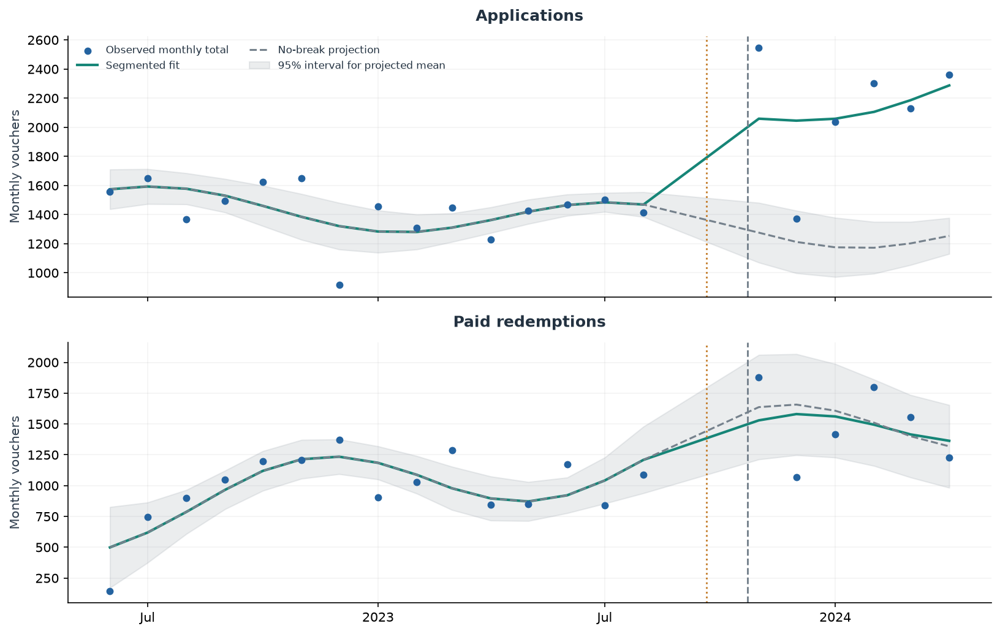
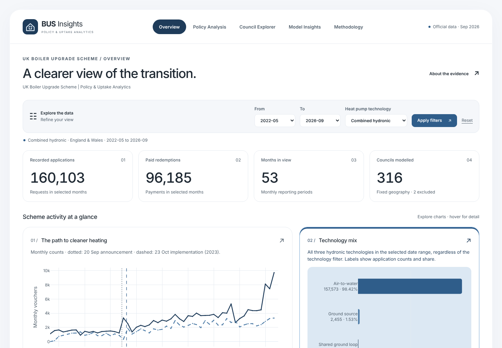
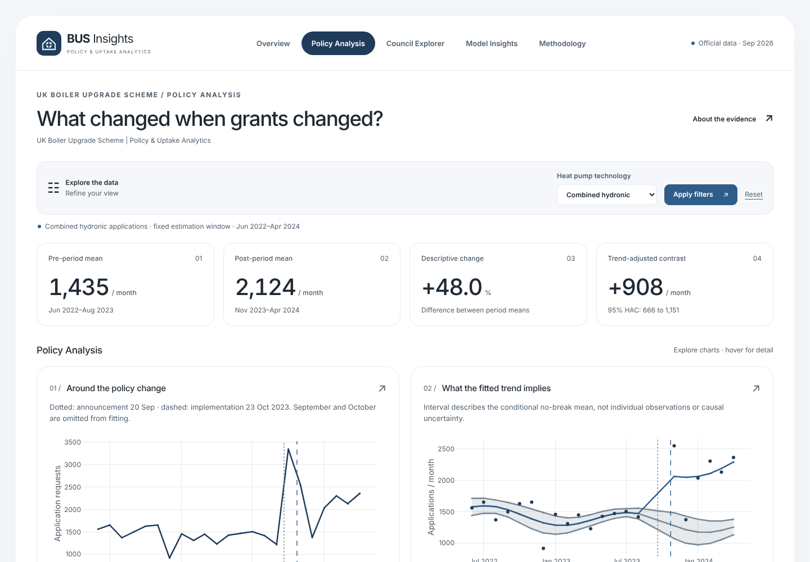
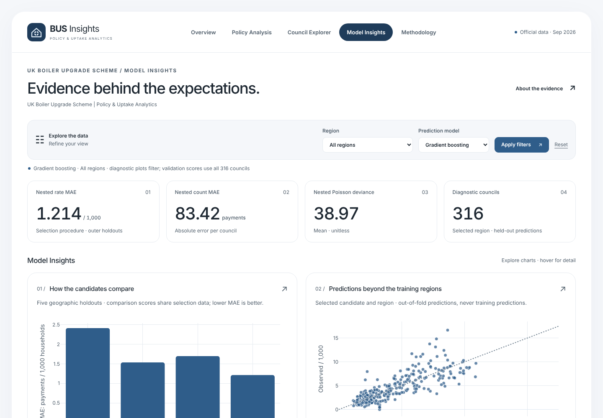

# UK Boiler Upgrade Scheme | Policy Impact & Heat Pump Adoption

Did increasing the UK's heat-pump grants coincide with higher demand? This project investigates the October 2023 grant changes using official government data, statistical modelling and machine learning. It also examines differences in grant uptake across 316 local authorities in England and Wales.

## Results at a glance

| **+48.0%** | **316 local authorities** | **49.7% lower prediction error** |
|:---|:---|:---|
| Observed rise in average monthly applications between selected pre- and post-policy periods. | Compared using housing, heating and gas-network characteristics. | Gradient boosting versus a pooled-rate baseline: geographic cross-validation MAE per 1,000 households. |

The fitted application contrast is **+908 requests per month** (95% HAC interval 666–1,151). This is a positive, model-dependent association; observational limitations prevent attributing it to the grant changes alone. Applications are requests, not completed installations.



*Observed counts, segmented fit and conditional no-break projection with a 95% interval for its mean. Dotted line: 20 September 2023 announcement; dashed line: 23 October implementation. The projection does not establish causation.*

## Interactive Analytics Dashboard

**BUS Insights** presents the results through five Flask pages with interactive Plotly charts and filters.

| Overview | Policy Analysis | Council Explorer & Model Insights |
|---|---|---|
| National trends, filtered KPIs and technology counts/shares. | Grant-change estimates, uncertainty and air-to-water sensitivity. | Housing context, held-out predictions, regional comparisons and validation errors. |

Methodology provides definitions, exclusions and official source links. National filters and cumulative council comparisons stay separate because their data has different levels of detail.

**Run locally:** see [setup below](#how-to-run-locally), then open [BUS Insights on this computer](http://127.0.0.1:5000/). This address is local, not a public website.

**Public deployment:** configuration is ready for Render Free; account sign-in and repository authorisation are still required. See [deployment instructions and current limits](docs/deployment.md). No public URL has been created or verified.

| Overview | Policy Analysis | Model Insights |
|---|---|---|
|  |  |  |

Screenshots are genuine captures of the running app (1440 × 1000, default filters). [Browser verification results](docs/browser-testing.md).

## Research questions

1. How did applications and paid redemptions change following the October 2023 heat-pump grant changes?
2. Which councils have lower uptake than their housing, heating and gas access would suggest?

## Datasets and methodology

Six official datasets combine monthly BUS activity, cumulative council payments, wider heat-pump deployment, Census 2021 housing/heating/tenure and 2024 off-gas estimates. The supplied BUS series covers May 2022–September 2026.

- **Policy analysis:** interrupted time series with trend, level/slope changes, annual seasonality and calendar-lag HAC intervals. Main window: June 2022–April 2024, excluding September/October transition months. Air-to-water sensitivity gives +901 requests/month (95% interval 667–1,135).
- **Council modelling:** pooled-rate baseline, Poisson, negative binomial and gradient boosting; cumulative payments per 1,000 Census 2021 households.
- **Validation:** five saved geographic folds hold out entire regions. Nested model selection uses four inner folds within each outer training set. It selects boosting in every outer fold, with rate MAE **1.214**, versus baseline **2.412** payments per 1,000 households. Candidate comparisons alone are selection-optimistic; these results do not guarantee future superiority.
- **Coverage:** 331 original Census districts are harmonised to 318. Of 318 BUS districts, 316 match; Barnsley and Sheffield remain excluded after a partial boundary transfer.

The [executed notebook](notebooks/01_data_understanding.ipynb) contains 13 embedded figures. See [detailed methods, full metrics, source versions and download filenames](docs/methodology.md) and the [policy summary](policy_summary.md).

## Technologies used

- **Analysis:** Python, pandas, NumPy, Matplotlib, statsmodels and scikit-learn.
- **Dashboard:** Flask, Jinja2, HTML, custom CSS, vanilla JavaScript and locally bundled Plotly.js.
- **Deployment:** Waitress WSGI server, Docker and a Render Blueprint. No database or request-time training.

## How to run locally

From the project root in PowerShell, using Python 3.12:

```powershell
py -3.12 -m venv .venv
.\.venv\Scripts\python.exe -m pip install -r requirements-dashboard.txt
.\.venv\Scripts\python.exe -m flask --app dashboard.app run --host 127.0.0.1 --port 5000
```

Reuse an existing `.venv` rather than recreating it. Open `http://127.0.0.1:5000`; Ctrl+C stops the development server. Included processed exports are sufficient to run the dashboard; raw downloads and analysis libraries are unnecessary for viewing it.

To reproduce the analysis, download the six historical source files following [the source instructions](docs/methodology.md#download-the-raw-data-before-rerunning-the-notebook), then run:

```powershell
.\.venv\Scripts\python.exe -m pip install -r requirements.txt
.\.venv\Scripts\python.exe run_notebook.py
.\.venv\Scripts\python.exe -m unittest discover -s tests -v
node --test tests/dashboard_interactions.test.cjs
```

The runner uses a fresh temporary `.venv` kernel, regenerates `data/processed/` and `outputs/`, and saves notebook outputs. Raw-file hashes and saved fold memberships guard reproducibility. The older `streamlit_prototype.py` is retained separately with `requirements-prototype.txt`.

**Verification:** automated tests cover routes, real filtered values, technology shares including zeros, council search/selection logic, model provenance and the minimal deployment data bundle. Live Flask and Waitress HTTP checks pass. All five pages were checked in headless Chromium at 1440, 1280, 768 and 390px: every chart rendered, with no console errors, failed requests or horizontal page overflow. The Docker image build and public deployment remain untested.

## Main limitations

- Short pre/post windows, anticipation, payment lags and other policy changes limit causal inference; no credible untreated control is available.
- Air-to-water grants rose £5,000 → £7,500; ground-source grants rose £6,000 → £7,500. Combined hydronic results do not represent a uniform £2,500 increase.
- Household denominators are from Census 2021, not a count of eligible properties. Monthly council histories, affordability and installer supply are unavailable.
- Regional rates cover matched councils. Area associations cannot explain individual choices; model gaps are descriptive comparisons, not government targets or equity measures.
- Earlier exploration and only ten regions constrain generalisation. ICF's reported 74% whole-scheme additionality is not the October 2023 grant-change effect.

## Data sources, attribution and licensing

| Source | Role |
|---|---|
| [DESNZ / Ofgem BUS, September 2026](https://www.gov.uk/government/statistics/boiler-upgrade-scheme-statistics-september-2026) | Applications, vouchers and cumulative council payments. |
| [DESNZ / MCS heat-pump deployment, June 2026](https://www.gov.uk/government/statistics/heat-pump-deployment-statistics-june-2026) | Wider retrofit market context. |
| [ONS TS044](https://www.ons.gov.uk/datasets/TS044/editions/2021/versions/4), [TS046](https://www.ons.gov.uk/datasets/TS046/editions/2021/versions/4), [TS054](https://www.ons.gov.uk/datasets/TS054/editions/2021/versions/4) | Census 2021 accommodation, heating and tenure; supplied version 4. |
| [DESNZ off-gas estimates](https://www.gov.uk/government/statistics/sub-national-estimates-of-households-not-connected-to-the-gas-network) | 2024 property estimate. |

Contains public sector information licensed under the [Open Government Licence v3.0](https://www.nationalarchives.gov.uk/doc/open-government-licence/version/3/), except where stated. Preserve OS and Royal Mail database-right notices in source geography tables. The BUS webpage's specific licence was not independently checked; workbook metadata and licensing qualifications are recorded in the [source notes](docs/methodology.md#attribution). Raw downloads are excluded from Git. [Plotly.js MIT notice](dashboard/THIRD_PARTY_NOTICES.md).

This is an independent educational analysis inspired by [ICF's published evaluation](https://www.gov.uk/government/publications/evaluation-of-the-boiler-upgrade-scheme-2026). It is not an official ICF product and is not endorsed by ICF, DESNZ or ONS.
